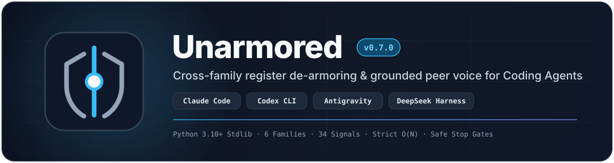
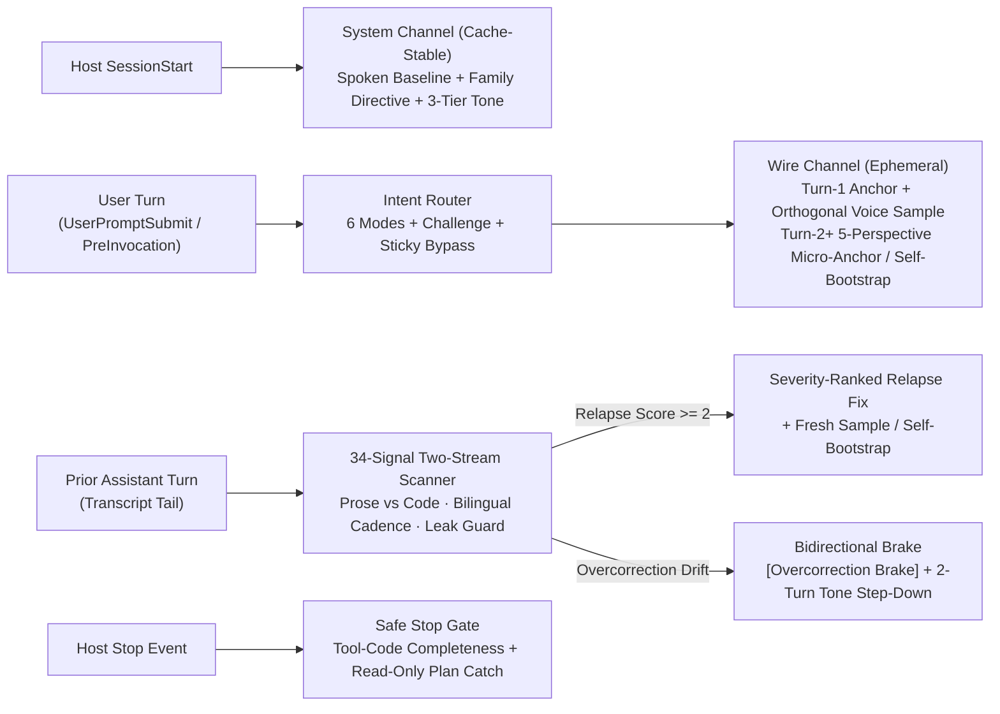

<p align="center">
  
</p>

<p align="center">
  
  
  
  
</p>

<p align="center">
  <a href="#quick-start">Quick Start</a> · <a href="#architecture-v07-dual-channel-bidirectional-loop">Architecture</a> · <a href="CHANGELOG.md">Changelog</a> · <a href="eval/README.md">Eval Harness</a>
</p>

---

**Cross-family register de-armoring, spoken-cadence voice exemplars, and bidirectional multi-turn calibration for Claude Code, OpenAI Codex CLI, Google Antigravity, and DeepSeek Harness (DSH).**

Unarmored does not replace host tool prompts, does not install theatrical roleplay personas, and requires zero trigger words. It breaks both Level-1 customer-support boilerplate and Level-2 bloodless tech-column prose using **orthogonal `<voice_sample scope="cadence_only">` exemplars + rotating Turn 2+ micro-anchors + session Self-Bootstrap + bidirectional overcorrection braking**, while keeping honest unverified disclosures and safe `Stop` gates intact. Bilingual English and Chinese sessions are auto-detected at runtime per turn.

---

## At a Glance: Before vs. After

> **Prompt**: *"Should a 6-person team split into microservices?"*

| Default Coding-Agent Output | With Unarmored v0.7 |
|---|---|
| *"That's a great question! Both monoliths and microservices are **mature choices**—it's **not black-and-white**, and the right choice **comes down to finding a balance**.<br>---<br>**### Pros of Microservices**<br>…(uniform op-ed essay)…<br>**Feel free to share your architecture diagram if you'd like me to help!**"* | **Honestly, don't bother—under 10 engineers, microservices mostly buy you pain.**<br><br>Services pay off when separate teams need independent deploy trains. When the same five people edit the code and carry the pager, you trade one database transaction for retries, idempotency, and distributed log archaeology.<br><br>Keep a modular monolith with clean boundaries; split a slice only when its scaling wall actually drags the whole app. |

---

## Why Abstract Rules or Roleplay Personas Alone Fall Short

| Real-World Failure Mode | Abstract System Prompt | Theatrical Roleplay Persona | **Unarmored v0.7** |
|---|---|---|---|
| **Abstract adjectives barely move RLHF priors** | "Talk like a peer" still outputs op-ed essays | Bloated boilerplate turns gimmicky | **Orthogonal `<voice_sample>` exemplars**: high-burstiness craft samples + **entity-leak guard** |
| **Turn 2+ swallowed by prior RLHF replies** | Silent Turn 2+ drifts back in 2 turns | Escalates or decays over long threads | **5-perspective rotating micro-anchors** (~20 tokens, zero cache loss) + **Self-Bootstrap**; coding turns stay silent `{}` |
| **Bloodless op-ed prose scores 0 on cliché lists** | Misses smooth uniform cadence | No objective cadence signal | **34-signal two-stream engine**: zero-dep bilingual `sent_len_cv`, `opener_diversity`, `flat_textbook_voice` |
| **Overcorrection into archaisms or empty snark** | One-way pressure with no brake | Drops facts for attitude | **Bidirectional `overcorrection_drift` brake**: catches archaisms/empty snark and steps tone down 1 tier for 2 turns |
| **Self-judging regex Goodhart overfitting** | Optimizes only for its own rules | No blinded validation | **`eval/judge.py` cross-family AB/BA blind judge** + **`eval/report.py` offline HTML diff viewer** |

---

## Architecture (v0.7 Dual-Channel Bidirectional Loop)



---

## Six-Family Targeted Counter-Armor

| Family | Matched Models | Signature RLHF Armor | Unarmored v0.7 Counter-Armor |
|---|---|---|---|
| **GPT** | `gpt-*`, `o1/o3/o4`, `codex` | Smooth op-ed essays, symmetrical aphorisms, praise-then-pivot, ritual balancing tails | Spoken cadence + orthogonal `<voice_sample>` + drops ritual balancing tails + Turn-1/2+ wire anchors |
| **DeepSeek** | `deepseek-*`, `ds-r1`, `ds-v*` | Meta-openers, `---` dividers, numbered tutorial decks, lazy code elisions | Keeps native bite & 100% runnable code + **3-variant rotating `DS_WIRE_VARIANTS`** against habituation |
| **Claude** | `claude-*`, `opus`, `sonnet`, `haiku` | Polite professor framing, implicit memo outlines, validation sandwiches, quiet soft-flip | Spoken peer prose + strong anti-FlipFlop grounding + orthogonal sample cadence lock |
| **Gemini** | `gemini-*`, `carbon`, `argon`, `gemma` | Opening flattery, hype-blogger dramatics, `###` headings & dividers | Everyday analogies & period-ended punches + full Antigravity bilingual baseline, mirror & Turn-1 anchors |
| **Grok** | `grok-*`, `x-ai/*` | Forced meme banter, cross-turn opener/metaphor recycling | Dry fact-tied wit + 3-turn `recent_openings` window against opener loops |
| **CN Flagships** | `qwen*`, `glm*`, `kimi*`, `minimax*`, `doubao*` | Bureaucratic framing, 4-char idioms, grand wrap-ups | Spoken conversational paragraphs + dedicated `cn_idiom_bureaucratese` detection |
| **Masked Pools** | `auto/*`, `group/*` | Hidden underlying provider/model | Starts on `generic`, locks onto real family via **behavioral fingerprinting** on relapse |

---

## Quick Start

Requires **Python >= 3.10** (stdlib-only, zero third-party dependencies; skips `WindowsApps` stubs on Windows).

```bash
# 1. Inspect runtime, resolved Python, and host installation states
python scripts/manage.py status

# 2. Install for one host or all (pass --target <dir> for workspace-scoped installs)
python scripts/manage.py install --agent claude      # codex | antigravity | dsh | all
python scripts/manage.py install --agent dsh --block-language en

# 3. Hot-switch tone stance (takes effect on the very next turn)
python scripts/manage.py configure --tone peer       # calm | peer (default) | sharp

# 4. Diagnose with visual badge summary & inline highlights, or compare two files
python scripts/manage.py diagnose --pretty --model gpt-5 \
  --prompt "Should a 6-person team split into microservices?" \
  --text "Both monoliths and microservices are mature choices. Ultimately, the right choice comes down to your team."
python scripts/manage.py diagnose --pretty --compare bare.txt v07.txt

# 5. Clean uninstall (hash-verified, preserves sibling hooks)
python scripts/manage.py uninstall --agent all
```

---

## Eval Harness, Cross-Family Blind Judge & Offline HTML Report

[`eval/`](eval/README.md) ships 49 core prompts + 30/30 active trigger checks, `--agent-scaffold --wire-anchor` stress testing (`bare` / `v05` / `v06` / `v07`), cross-family AB/BA blind judging, and a zero-CDN single-file HTML diff report:

```bash
export UNARMORED_EVAL_BASE_URL=https://your-endpoint/v1
export UNARMORED_EVAL_API_KEY=...

python eval/run.py --models <model-id> --families gpt --conditions bare,v06,v07 --agent-scaffold --wire-anchor --dry-run
python eval/judge.py --results eval/out/<run>/results.jsonl --cond-a bare --cond-b v07 --judge-model claude-sonnet-4 --strict-cross-family
python eval/report.py --results eval/out/<run>/results.jsonl --judge eval/out/<run>/judge_bare_vs_v07.json --baseline bare --target v07 --export-regressions eval/out/<run>/regressions.jsonl
```

---

## Profile Packs (`unarmored-pack/1`)

User or team overlays (`model_aliases`, `model_strip_patterns`, sticky `bypass` markers, `roles`, `voice`, `voice_exemplars`, and `directives.<family>`) live outside the public repository; see [`examples/packs/example.pack.json`](examples/packs/example.pack.json).

---

## Safety Boundary, Tests & Release Checks

> [!IMPORTANT]
> **Safety Boundary**: Unarmored operates strictly on the **style and register layer**. It does not attempt to weaken, bypass, or modify harm-refusal safety guardrails.

```bash
python -m unittest discover -s tests -v                  # Full test suite (O(N) ReDoS, blind judge/report, Windows multi-shell)
python scripts/build_release.py                         # Validates manifests/OpSec & builds deterministic dist/unarmored-v0.7.0.zip
python scripts/build_release.py --export-tree ../export # Exports a clean git-ready public source tree
```

Set `UNARMORED_OPSEC_DENYLIST=<file>` (or add `.opsec-denylist.txt`) to guard public trees and release archives against private term leaks. Junction-fixture tests are opt-in via `UNARMORED_ALLOW_REPARSE_TESTS=1`.

## License

[Apache License 2.0](LICENSE)
