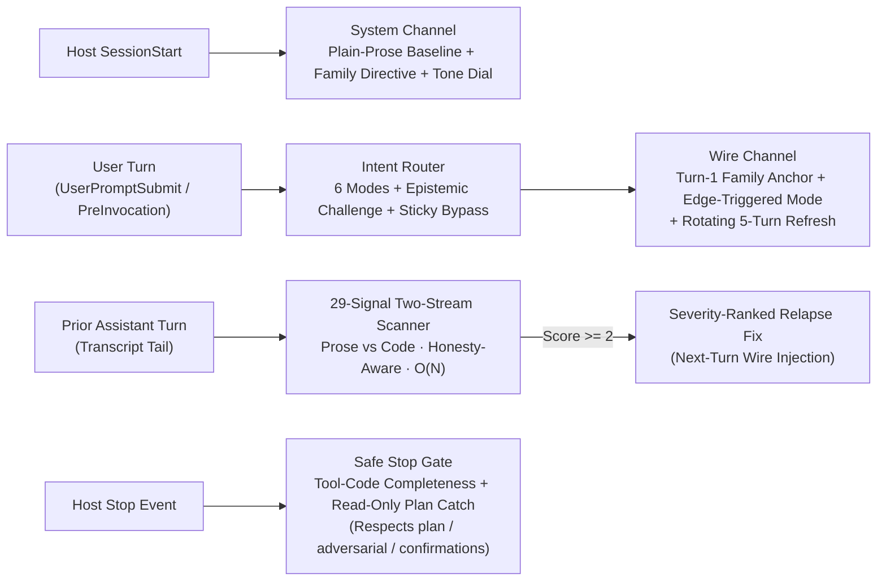

<p align="center">
  
</p>

<p align="center">
  
  
  
  
</p>

<p align="center">
  <strong>简体中文</strong> · <a href="README_en.md">English</a> · <a href="CHANGELOG.md">Changelog</a> · <a href="eval/README.md">Eval Harness</a>
</p>

---

**面向 Claude Code、OpenAI Codex CLI、Google Antigravity 与 DeepSeek Harness (DSH) 的跨模型家族语域去甲与多轮校准插件。**

不替换宿主工具提示词，不套中二或毒舌总监的 Roleplay 人设，也不用记任何触发词。核心只做一件事：**让前沿模型把机制、风险和代码讲透，同时像坐对面的熟人行家那样带着对事的真实体感直说**——剥掉顾问端水腔、先夸再转折、免责叠甲、文档式标题横线、大砖头不分段与被质疑就倒戈，同时完整保留“没实测、未验证、有硬风险”的诚实工程汇报。

---

## 一眼看懂：开启前 vs 开启后

> **提问**：「十人以内的小团队适合上微服务吗？」

| 默认编码代理输出（未去甲） | 开启 Unarmored v0.6 后 |
|---|---|
| *「这是一个非常有价值的问题！微服务和单体架构**不是非黑即白的选择**，两者**各有优劣**，需要根据团队规模在灵活性与复杂度之间**寻找平衡点**。<br>---<br>**### 一、微服务的优势**<br>…（400 字不分段大砖头）…<br>总体而言取决于你们的具体场景。**如果你愿意告诉我更多业务细节，我可以进一步帮你梳理架构图！**」* | **十人以内别上微服务，大概率是在给自己找罪受。**<br><br>微服务的收益是让不同团队独立发版、隔离扩容。如果需求还是同一拨人改、出故障半夜还是同一拨人接，你换不来独立交付，只多出分布式事务、重试幂等和跨日志排查的维护税。<br><br>先用模块化单体把代码边界划清；真等某个热点模块反复拖着全站扩容，或者两个小组天天互相卡发布窗口，再单拆那一块。 |

---

## 为什么不用“一段静态提示词”或“毒舌人设”？

| 痛点 | 一段静态 System Prompt | 角色扮演（毒舌/极客模板） | **Unarmored v0.6** |
|---|---|---|---|
| **20–40 KB 编码代理提示词稀释** | 埋在 Index-0，Turn 1 几乎不起效 | 要写几百字才能压过系统提示 | **双通道穿透**：`SessionStart` 系统基线 + **全家族 Turn-1 用户近端微锚点** |
| **多轮上下文膨胀与钝化** | 每轮重发浪费 Token，不发又漂移 | 长对话迅速退化或越来越油腻 | **边沿触发 6 模式信封**（同模式静默 `{}`）+ **每 5 轮轮换保鲜脉冲** |
| **跨模型家族截然不同的毛病** | 压不住 DeepSeek 横线或 Gemini 夸夸 | 经常把模型带偏成尴尬段子手 | **6 大家族靶向破甲** + **盲路由行为指纹反推** |
| **误伤诚实工程不确定性** | 硬禁“取决于/参考”会逼出幻觉 | 假装全懂、掩盖未验证风险 | **诚实感知检测**：明确交代未实测/静态推断自动豁免，绝不放过硬套话 |
| **只读/方案模式被钩子误拦** | 无门禁或一刀切乱拦 | 无执行完备保障 | **安全 `Stop` 门禁**：尊重 `plan`/`read-only`、只读复核角色与破坏性确认 |

---

## 架构总览（v0.6 四层闭环）



---

## 六大模型家族靶向破甲

| 模型家族 | 识别前缀 / 别名 | 后训练典型“铠甲” | Unarmored v0.6 破甲策略 |
|---|---|---|---|
| **GPT** | `gpt-*`, `o1/o3/o4`, `codex` | 先夸再转折、顾问端水找平衡、400 字大砖头、客服菜单 | 正面反制端水与大砖头 + Turn-1 `[直出·GPT]` 近端穿透 + 保留内联具体风险 |
| **DeepSeek** | `deepseek-*`, `ds-r1`, `ds-v*` | 开头播报、狂画 `---` 分割线、1-2-3-4 教程清单、代码省略 | 保留锐度与 100% 完整代码 + 每聊天轮 `[DS直出提醒]` 直入 `<think>` 高注意力区 |
| **Claude** | `claude-*`, `opus`, `sonnet`, `haiku` | 文档式标题排版、客套背书三明治、端架子说教、质疑倒戈 | 活人同行散文 + 英文反倒戈/硬收笔尾锚 + Turn-1 `[直出·Claude]` |
| **Gemini** | `gemini-*`, `carbon`, `argon`, `gemma` | 开场捧场、感叹号/句内加粗堆砌、`###` 标题与横线 | 情绪改道至生动类比 + 锁死标题/横线/结尾揽活 + Antigravity 中文镜像 |
| **Grok** | `grok-*`, `x-ai/*` | 刻意玩梗耍贫嘴、跨轮复读旧比喻与开头 | 保留贴合事实的辛辣直白 + 强制每轮淘汰旧比喻与旧起手 |
| **CN 主力** | `qwen*`, `glm*`, `kimi*`, `minimax*`, `doubao*` | 申论公文架子、强拆一二三四、结尾拔高升华 | 打碎公文骨架，长短句交替成段，停在最后一句干货上 |
| **聚合网关** | `auto/*`, `group/*` | 隐藏真实底层模型 ID | 起点走 `generic`，一旦暴露家族口癖自动通过**行为指纹**锁定对应靶向策略 |

---

## 支持的宿主

| 宿主 | 接入方式 | 动态干预能力 |
|---|---|---|
| **Claude Code** | 生命周期钩子（`SessionStart` / `UserPromptSubmit` / `PostModelSwitch` / `PreCompact` / `Stop`） | 全功能（边沿 6 模式 + 全家族 Turn-1 近端锚点 + 5 轮轮换保鲜 + 安全 `Stop` 门禁） |
| **OpenAI Codex CLI** | `.codex/hooks.json`（严格符合 `serde(deny_unknown_fields)`） | 全功能（含 PowerShell / `cmd.exe` 双壳安全 `commandWindows`） |
| **Google Antigravity** | 插件目录 + `hooks.json` + 常驻 `rules/AGENTS.md` | 全功能（含中文镜像 + 全 6 模式边沿触发 + `invocationNum > 1` 热路径零开销） |
| **DeepSeek Harness (DSH)** | 在 `AGENTS.md` 写入带起止标记的静态规则块 + 安装 skill | 静态规则校准（可幂等安装与无痕卸载） |

---

## 30 秒快速上手

要求 **Python ≥ 3.10**，纯标准库零第三方依赖；Windows 下自动跳过 `WindowsApps` 空壳存根并兼容带空格/特殊字符路径。

```bash
# 1. 查看环境、Python 路径与已安装宿主状态
python scripts/manage.py status

# 2. 按需安装（支持 claude / codex / antigravity / dsh / all；加 --target <目录> 仅装到单个项目）
python scripts/manage.py install --agent claude
python scripts/manage.py install --agent dsh --block-language zh

# 3. 热切语气档位（立刻生效，无需重启宿主）
python scripts/manage.py configure --tone peer   # calm（克制同事）| peer（默认，直率熟人）| sharp（犀利直球）

# 4. 现场诊断一段模型输出 + 预览用户提问的意图路由与微锚点
python scripts/manage.py diagnose --model gpt-5 \
  --prompt "十人以内的团队适合上微服务吗？" \
  --text "这不是非黑即白的选择，我们需要在灵活性和复杂度之间寻找平衡点。"

# 5. 无痕卸载（先校验文件哈希，不动其他插件的同级钩子）
python scripts/manage.py uninstall --agent all
```

<details>
<summary>查看上面 <code>diagnose --prompt</code> 命令的实跑 JSON 关键字段节选（略去长指令原文）</summary>

```json
{
  "model_family": "gpt",
  "detected_language": "zh",
  "relapse_score": 2,
  "triggers_injection": true,
  "matched_smells": ["consultant_balance"],
  "wire_anchor": "[直出·GPT] 别端着写成温和顾问稿或一整块大砖头：第一句直亮判断和真实体感，2-4 句短段讲透因果，说完立刻停。",
  "remedy_directive": "[语域纠偏] 上一轮又滑回了套路/排版惯性（顾问式端水与机械权衡）。这一轮回到熟人直说、带着对事的真态度讲清楚，第一句直接给判断（重点：第一句直接站队并给改口门槛）。",
  "classified_intent": "CRITIQUE_OPINION",
  "allows_disk_edits": false,
  "is_epistemic_challenge": false
}
```

</details>

---

## 评测台与真实代理压力测试

[`eval/`](eval/README.md) 内置 49 题核心评测集 + 30 题高发诱因集，并支持 `--agent-scaffold --wire-anchor` 在 ~6 KB 通用编码代理系统提示稀释下直接 A/B 对照 `bare` / `v03` / `v04` / `v05` / `v06`：

```bash
export UNARMORED_EVAL_BASE_URL=https://your-endpoint/v1
export UNARMORED_EVAL_API_KEY=...
python eval/run.py --models <model-id> --families gpt --conditions bare,v05,v06 --agent-scaffold --wire-anchor --dry-run
```

---

## 配置包（`unarmored-pack/1`）

个人或团队的模型别名、网关前缀剥离、角色策略（`skip / terse / adversarial / persona / default`）、粘性绕过标记（`session_patterns` / `prompt_markers` / `system_markers`）与定制口吻可通过 JSON 配置包叠加，本公开仓库不带任何私人配置包，完整样例见 [`examples/packs/example.pack.json`](examples/packs/example.pack.json)。

加载优先级：`<安装目录>/packs/*.json` → `<状态目录>/packs/*.json`（`$UNARMORED_STATE_DIR` → `$PLUGIN_DATA/unarmored` → `~/.unarmored`）→ `$UNARMORED_PACK`（后者覆盖前者）；`config.json` 覆盖配置包标量默认值。

---

## 安全边界、测试与发布校验

> [!IMPORTANT]
> **安全边界**：Unarmored 严格限定在**风格与语域层**，不提供、不包含也不支持任何绕过有害内容安全拒绝的机制。

```bash
python -m unittest discover -s tests -v                  # 运行全套 49 项单测（含全正则 O(N) ReDoS 与 Windows 四壳矩阵）
python scripts/build_release.py                         # 校验版本/清单/OpSec 并生成可复现 dist/unarmored-v0.6.0.zip
python scripts/build_release.py --export-tree ../export # 导出干净、可直接发布的公开源码树
```

设置 `UNARMORED_OPSEC_DENYLIST=<文件>` 或放置 `.opsec-denylist.txt` 可在构建前扫描公开树与发行包；`packs/` 目录严禁进入公开仓库。会创建 Windows 目录联接的测试默认跳过（`UNARMORED_ALLOW_REPARSE_TESTS=1` 开启）。

## 许可证

[Apache License 2.0](LICENSE)
