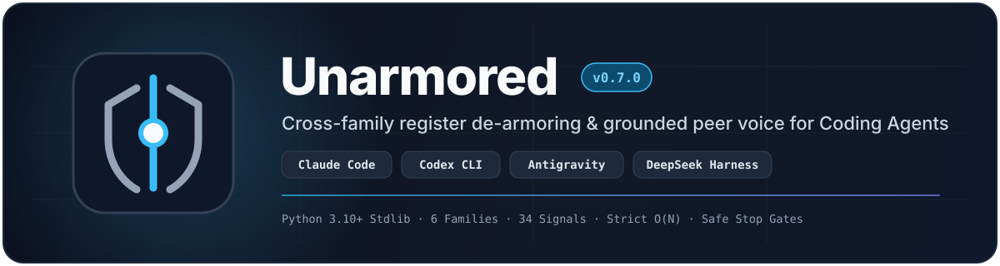
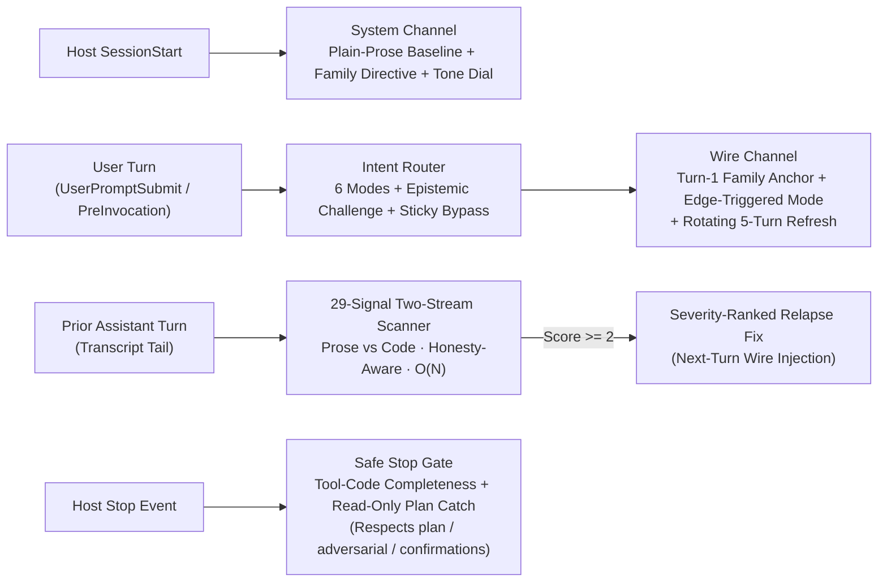

<p align="center">
  
</p>

<p align="center">
  
  
  
  
</p>

<p align="center">
  <a href="README.md">简体中文</a> · <strong>English</strong> · <a href="CHANGELOG.md">Changelog</a> · <a href="eval/README.md">Eval Harness</a>
</p>

---

**Cross-family register de-armoring, grounded peer voice, and edge-triggered multi-turn calibration for Claude Code, OpenAI Codex CLI, Google Antigravity, and DeepSeek Harness (DSH).**

Unarmored does not replace host tool prompts, does not install theatrical roleplay personas, and requires zero trigger words. Its goal is straightforward: **explain mechanisms, risks, and trade-offs with total clarity while speaking like a sharp peer across the table**—stripping consultant balance-hedging, praise-then-pivot buffers, generic disclaimers, doc-in-chat divider decks, single-brick walls of text, and sycophantic flip-flopping while keeping honest unverified disclosures completely intact.

---

## At a Glance: Before vs. After

> **Prompt**: *"Should a 6-person team split into microservices?"*

| Default Coding-Agent Output | With Unarmored v0.6 |
|---|---|
| *"That's a great question! Both monoliths and microservices are **mature choices**—it's **not black-and-white**, and the right choice **comes down to finding a balance**.<br>---<br>**### Pros of Microservices**<br>…(unbroken wall of text)…<br>Ultimately it depends on your context. **Feel free to share your architecture diagram if you'd like me to help you plan the migration!**"* | **No—under 10 engineers, microservices mostly buy you operational pain.**<br><br>Services pay off when separate teams need independent deploy trains or isolated scaling. When the same five people edit the code and carry the pager, you trade one database transaction for retries, idempotency, and distributed log archaeology.<br><br>Start with a modular monolith and clean module boundaries. Split a slice only when its scaling profile drags the whole app or two teams genuinely block each other's releases. |

---

## Why Not a Static System Prompt or Roleplay Persona?

| Real-World Failure Mode | Static System Prompt | Theatrical Roleplay Persona | **Unarmored v0.6** |
|---|---|---|---|
| **Diluted by 20–40 KB agent prompts** | Buried at index 0; fades by Turn 1 | Needs huge boilerplate to compete | **Dual-channel penetration**: `SessionStart` baseline + **universal Turn-1 user-adjacent wire anchors** |
| **Multi-turn context bloat & drift** | Repeating wastes tokens; silence drifts | Turns caricatured or decays over long threads | **Edge-triggered 6-mode envelopes** (`{}` on steady state) + **rotating 5-turn refresh pulses** |
| **Model-specific post-training armor** | Misses DeepSeek dividers or Gemini hype | Flattens technical rigor into snark | **6-family targeted counter-armor** + **behavioral fingerprinting** for masked routes |
| **Penalizing honest uncertainty** | Naive regexes flag "untested / depends" | Encourages fake certainty | **Honesty-aware scanner**: exempts explicit unverified disclosures while catching hard cliches |
| **False blocks on plan/review turns** | No execution completeness guard | No tool-write verification | **Safe `Stop` gates**: honors `plan`/`read-only`, sticky `adversarial` roles, and confirmation asks |

---

## Architecture (v0.6 Four-Layer Closed Loop)



---

## Six-Family Targeted Counter-Armor

| Family | Matched Models | Signature RLHF Armor | Unarmored v0.6 Counter-Armor |
|---|---|---|---|
| **GPT** | `gpt-*`, `o1/o3/o4`, `codex` | Praise-then-pivot, balance-seeking hedging, single-brick walls of text, closing menus | Counters consultant balance & bricks + Turn-1 `[Direct:GPT]` wire anchor + inline concrete risks |
| **DeepSeek** | `deepseek-*`, `ds-r1`, `ds-v*` | Meta-openers, `---` divider spam, numbered tutorial decks, lazy code elisions | Preserves sharpness & 100% runnable code + per-chat-turn `[DS Direct]` recency anchor into `<think>` |
| **Claude** | `claude-*`, `opus`, `sonnet`, `haiku` | Doc-in-chat headings, validation sandwiches, lecturing, sycophantic Flip-Flop | Candid peer prose + English anti-FlipFlop & hard-stop tail + Turn-1 `[Direct:Claude]` |
| **Gemini** | `gemini-*`, `carbon`, `argon`, `gemma` | Opening flattery, exclamation/bold spam, `###` headings & dividers | Redirects energy to vivid causal analogies + clamps headings/dividers/offers + Antigravity ZH mirror |
| **Grok** | `grok-*`, `x-ai/*` | Forced meme banter, cross-turn opener/metaphor recycling | Keeps dry bite tied strictly to facts + retires prior-turn openings and metaphors |
| **CN Flagships** | `qwen*`, `glm*`, `kimi*`, `minimax*`, `doubao*` | Bureaucratic report framing, forced 1-2-3-4 headers, grand wrap-ups | Conversational paragraphs with varied cadence stopping on the final useful fact |
| **Masked Pools** | `auto/*`, `group/*` | Hidden underlying provider/model | Starts on `generic`, locks onto real family via **behavioral fingerprinting** on relapse |

---

## Supported Hosts

| Host | Integration | Dynamic Mid-Session Calibration |
|---|---|---|
| **Claude Code** | Lifecycle hooks (`SessionStart` / `UserPromptSubmit` / `PostModelSwitch` / `PreCompact` / `Stop`) | Full (edge-triggered 6 modes + Turn-1 wire anchors + rotating 5-turn refresh + safe `Stop` gates) |
| **OpenAI Codex CLI** | `.codex/hooks.json` (strict `serde(deny_unknown_fields)` compliant) | Full (incl. PowerShell & `cmd.exe` safe `commandWindows`) |
| **Google Antigravity** | Plugin directory + `hooks.json` + persistent `rules/AGENTS.md` | Full (incl. Chinese mirror + all 6 modes edge-triggered + `invocationNum > 1` fast path) |
| **DeepSeek Harness (DSH)** | Marked static rules block in `AGENTS.md` + skill | Static calibration (idempotent install & clean hash-verified uninstall) |

---

## Quick Start

Requires **Python ≥ 3.10** (stdlib-only, zero third-party dependencies; automatically skips `WindowsApps` stubs on Windows).

```bash
# 1. Inspect runtime, resolved Python, and host installation states
python scripts/manage.py status

# 2. Install for one host or all (pass --target <dir> for workspace-scoped installs)
python scripts/manage.py install --agent claude      # codex | antigravity | dsh | all
python scripts/manage.py install --agent dsh --block-language en

# 3. Hot-switch tone stance (takes effect on the very next turn)
python scripts/manage.py configure --tone peer       # calm | peer (default) | sharp

# 4. Diagnose sample model output + preview intent routing & wire anchor
python scripts/manage.py diagnose --model gpt-5 \
  --prompt "Should a 6-person team split into microservices?" \
  --text "Both monoliths and microservices are mature choices. Ultimately, the right choice comes down to your team."

# 5. Clean uninstall (hash-verified, preserves sibling hooks)
python scripts/manage.py uninstall --agent all
```

---

## Eval Harness & Agent-Scaffold Stress Test

[`eval/`](eval/README.md) ships 49 core prompts + 30 trigger prompts and supports `--agent-scaffold --wire-anchor` to benchmark `bare` / `v03` / `v04` / `v05` / `v06` under a realistic ~6 KB generic coding-agent system prompt:

```bash
export UNARMORED_EVAL_BASE_URL=https://your-endpoint/v1
export UNARMORED_EVAL_API_KEY=...
python eval/run.py --models <model-id> --families gpt --conditions bare,v05,v06 --agent-scaffold --wire-anchor --dry-run
```

---

## Profile Packs (`unarmored-pack/1`)

User or team overlays (`model_aliases`, `model_strip_patterns`, sticky `bypass` markers, `roles`, `voice`, and `directives.<family>`) live outside the public repository; see [`examples/packs/example.pack.json`](examples/packs/example.pack.json).

---

## Safety Boundary, Tests & Release Checks

> [!IMPORTANT]
> **Safety Boundary**: Unarmored operates strictly on the **style and register layer**. It does not attempt to weaken, bypass, or modify harm-refusal safety guardrails.

```bash
python -m unittest discover -s tests -v                  # 49 tests (incl. exhaustive O(N) ReDoS & Windows multi-shell matrix)
python scripts/build_release.py                         # Validates manifests/OpSec & builds deterministic dist/unarmored-v0.6.0.zip
python scripts/build_release.py --export-tree ../export # Exports a clean git-ready public source tree
```

Set `UNARMORED_OPSEC_DENYLIST=<file>` (or add `.opsec-denylist.txt`) to guard public trees and release archives against private term leaks. Junction-fixture tests are opt-in via `UNARMORED_ALLOW_REPARSE_TESTS=1`.

## License

[Apache License 2.0](LICENSE)
